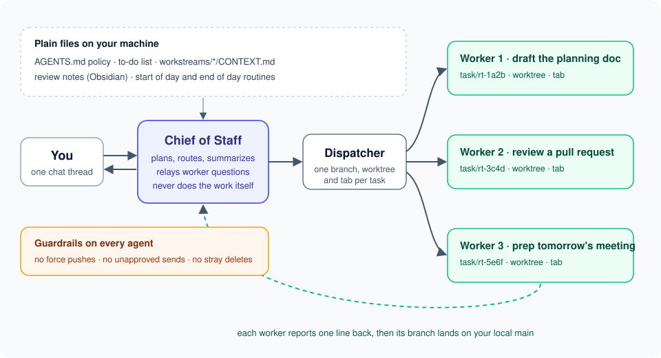
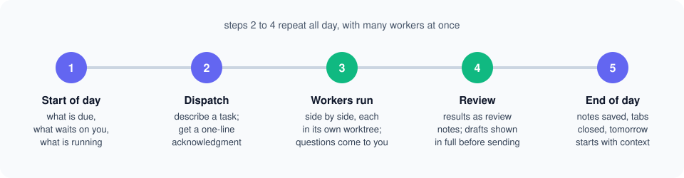
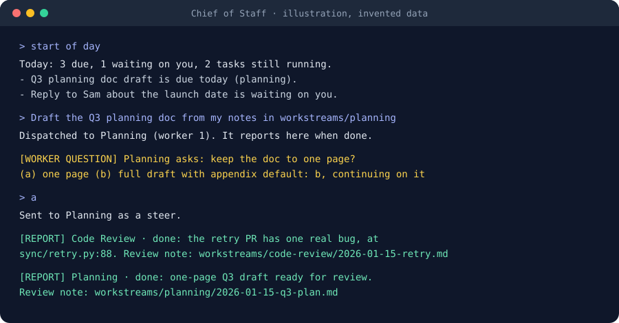

# switchboard

**Run a team of AI coding agents from one chat.**

switchboard is a personal operating system for working with many coding agents at once. You talk to one agent, the Chief of Staff. It plans your day, turns each ask into a task, and hands every task to its own worker agent in its own terminal tab and its own git worktree. Workers do the work in parallel, and each one reports back with a one-line result. When a worker finishes, its branch lands on your local `main`. Your to-do list, your notes and your project context stay as plain files on your machine.


It started as a personal setup for running a working day with agents, so the examples lean toward PM work: drafting docs, reviewing pull requests, preparing meetings, triaging messages. Nothing in it is PM-specific. Engineers, designers, researchers and founders use the same loop for anything they can describe to an agent.



## Why you might want this

- **Parallel without chaos.** Ten agents can work at once and never step on each other: one task, one branch, one worktree, one tab. Landing is a rebase and fast-forward on your local `main`, and a conflict comes back to you as a question.
- **One place to talk.** You stay in one thread. Workers never wait for you in their own tabs. When a worker needs a decision, the question comes to the Chief of Staff with options and a default, and the worker keeps going on the default.
- **Your day has a shape.** A start-of-day routine builds a plan from your to-do list, calendar and open work. An end-of-day routine saves what happened and what is next, so tomorrow's agents start with context instead of a blank page.
- **Plain files, your machine.** Policy is one `AGENTS.md`. Context is Markdown in the same folder, which is also an Obsidian vault. Nothing is sent anywhere unless you connect a service and ask for it.
- **Guardrails built in.** Hooks block risky commands (force pushes, blanket `git add -A`, deleting outside scratch folders). Messages to other people are drafted for you to approve and never sent on their own.
- **Any agent.** One policy file, thin adapters. The full parallel loop runs with Claude Code or Amp. Codex CLI, Cursor, Gemini CLI and chat tools get the same policy and skills in a single session.

## Install with one prompt

Open your coding agent (Claude Code, Codex, Amp, Cursor or another) in an empty folder and paste:

```
Install switchboard from https://github.com/abhiroopb/switchboard. Clone it into ~/Development/switchboard-src, read INSTALL.md, and follow it. Ask me only the questions it lists.
```

The agent checks your machine, asks you up to nine short questions (your name, your email, the folder to install into, which agents to set up, the full loop or a single session, your time zone, which services to connect now, how agents may use a browser, and which surfaces open each day), shows you a dry run, installs, and runs the checks. You run every sign-in yourself, and no token is written into the repo. The steps it follows are in [INSTALL.md](INSTALL.md), so you can also run them yourself.

## What a day looks like



1. **Start of day.** Type `start of day` in the Chief of Staff tab. You get today's plan: what is due, what is waiting on you, and which work is still running.
2. **Dispatch.** Describe a task in plain words, for example `Draft the Q3 planning doc from my notes in workstreams/planning`. The Chief of Staff picks or creates a workstream, opens a worker, and replies with one line.
3. **Keep working.** Dispatch more. Workers run side by side. Their questions and results arrive in the Chief of Staff thread, and anything you must do lands on your to-do list.
4. **Review.** Deliverables arrive as Markdown review notes you can open in Obsidian or any editor, with drafts shown in full.
5. **End of day.** Type `end of day`. The Chief of Staff saves durable notes, closes finished tabs and leaves a clear starting point for tomorrow.



## What you get

| Piece | What it does | Where |
|---|---|---|
| Operating contract | The rules every agent follows: routing, reporting, writing style, safety. | `AGENTS.md` |
| Chief of Staff | Plans, routes and summarizes. It never does the work itself. | `system/chief-of-staff-prompt.md`, `routines/` |
| Dispatcher | One worktree, branch and tab per task, plus landing, retries and cleanup. | `system/scripts/dispatch.py`, `router-dispatch.sh`, `report-to-cos.sh` |
| Terminal integration | cmux on macOS, wmux on Windows, with one shared interface. | `system/scripts/lib/mux.py`, `system/windows/` |
| To-do list | A local to-do list with priorities, due dates and optional calendar holds. | `system/skill-overrides/todo/` |
| Skills | Chief of staff, closing the day, drafting docs, recall, triage of links, prototypes, presentations, git and pull request helpers, and 31 bundled third-party skills. | `.agents/skills/`, `system/vendor/skills/` |
| Reviewers | Reviewer personas (engineer, designer, skeptic, security and more) for a second opinion on any draft. | `sub-agents/` |
| Connectors | Optional Google (Gmail, Calendar, Drive, Docs, Sheets, Slides), Dropbox, GitHub and Slack access through your own apps and sign-ins. | `system/connectors/`, [docs/connectors.md](docs/connectors.md) |
| Guardrails | Hooks and plugins that block risky commands and unapproved sends. | `.claude/hooks/`, `system/amp-plugins/` |
| Templates | PRD, decision, meeting, status and review note templates. | `templates/` |

## Requirements

- **Everywhere:** Python 3.11 or newer with PyYAML, git and ripgrep.
- **The full parallel loop:** macOS with [cmux](https://github.com/manaflow-ai/cmux), or Windows 11 with [wmux](https://wmux.org). Your workers run Claude Code or Amp.
- **A single session (any OS, any terminal):** any coding agent that reads `AGENTS.md`, or any chat tool that takes a system prompt. You get the policy, skills, to-do list, routines and review notes, and the agent works through tasks one at a time in the same session.
- **Optional:** Obsidian for reading notes, `gh` for GitHub work, Bun for the Claude Code plugin hooks.

## How it works

The short version is above. The long version, with every moving part, is in [docs/how-it-works.md](docs/how-it-works.md). Adding your own skills, workstreams, rules and an organization profile is in [docs/customize.md](docs/customize.md). Your first day, step by step, is in [docs/first-day.md](docs/first-day.md). Connecting Google, Dropbox, GitHub and Slack is in [docs/connectors.md](docs/connectors.md). Letting agents use a browser safely is in [docs/browser-control.md](docs/browser-control.md).

## Safety and privacy

- **Local first.** Your notes, to-do list, people profiles and state live in your install folder. The folders that hold private data (`local/`, `people/`, `notes/sensitive/`, `system/state/`) are gitignored.
- **No sends without you.** Slack messages and emails are drafted and shown in full. They go out only when you say "send it" for that exact text.
- **No pushes by default.** Your switchboard folder has no remote, and its automatic push stays off unless you turn it on.
- **Leak gates.** If you share your own copy, `system/kit/` builds a filtered public version and refuses to publish anything that matches your private deny lists, a personal-data detector or a secret scanner. See [SECURITY.md](SECURITY.md).

Background jobs run under your own accounts and credentials. Read `AGENTS.md` and the guardrail hooks before you turn the background loop on.

## License

switchboard's own code and docs are free for personal and other noncommercial use under the [PolyForm Noncommercial License 1.0.0](LICENSE.md). Commercial use is not permitted. The bundled third-party skills keep their own MIT or Apache-2.0 licenses, listed in [THIRD_PARTY_NOTICES.md](THIRD_PARTY_NOTICES.md).

## FAQ

**Is this a product or a framework?** It is a working setup you install and then make your own. It has opinions about how agents should behave, and every one of them lives in a file you can edit.

**Do I need to be a product manager?** No. The examples come from PM work, but the loop is the same for any work you can hand to an agent.

**What are the names in the code?** Everything is called switchboard: folders, scripts, plugins and skills use `switchboard`, environment variables start with `SWITCHBOARD_`, per-user state lives in `~/.switchboard`, and the install manifest is in `.switchboard-kit/`. Two internal names share it: the connector command is `switchboard` (as in `switchboard mail show`), and the Chief of Staff tab's routine lives in `routines/switchboard/`.

**Does it work on Linux?** The single-session mode does. The parallel loop needs cmux or wmux, which run on macOS and Windows.

**Can several agents edit the same file at once?** Each worker has its own worktree, so edits never collide while work is running. If two workers change the same lines, the second one to land gets a rebase conflict to resolve, and the dispatcher tells you.

**What does it cost?** switchboard itself is free for noncommercial use. Your agents bill you as usual.
